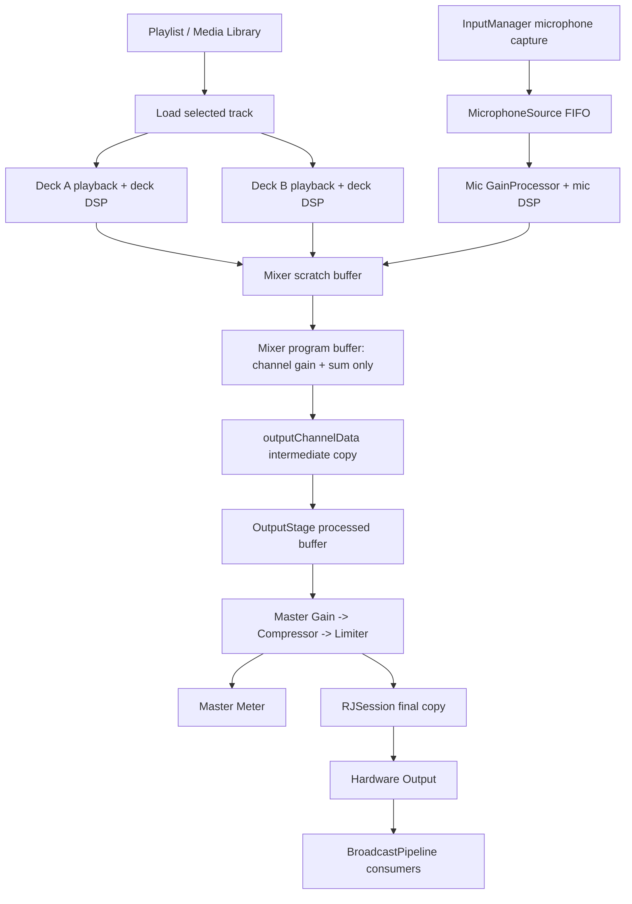
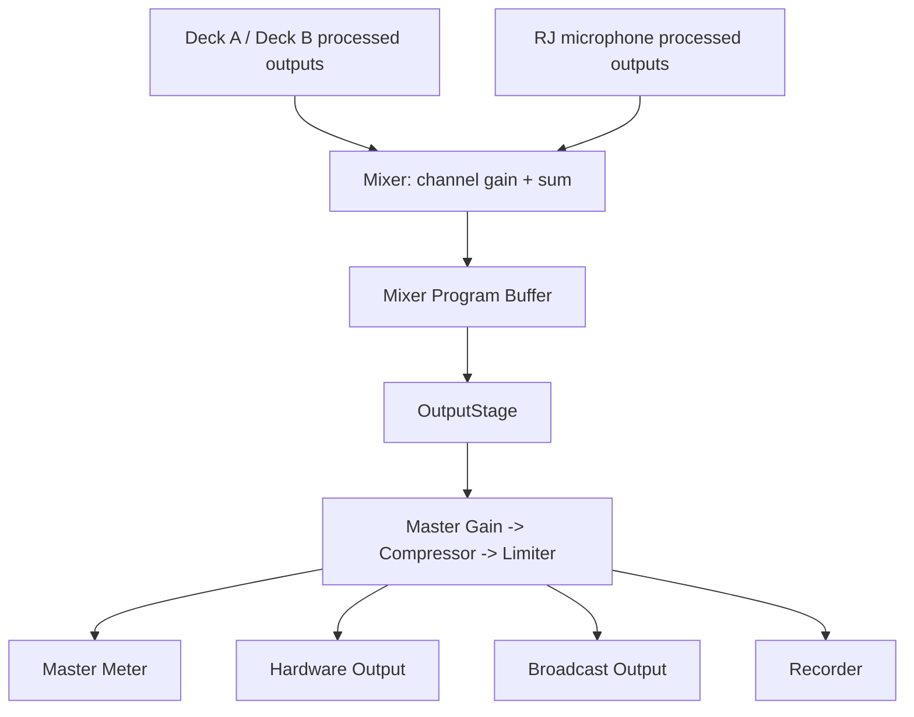

# Master Bus Validation

Validation date: 2026-06-26

Scope: RJ regression stabilization only. No Podcast code, SessionManager architecture changes, SDK expansion, multi-microphone routing, or Phase 2 master-bus optimization were implemented.

## Root Cause of Distortion

The distortion came from fragile buffer ownership between `Mixer`, `OutputStage`, `RJSession`, and `outputChannelData`.

Before this fix, `Mixer::process()` copied its program buffer into `outputChannelData`, then `OutputStage::process()` copied that hardware buffer into its own processed buffer, then `RJSession::process()` copied the processed buffer back into `outputChannelData`. This path was redundant and made the valid callback sample count easy to mishandle.

The most dangerous issue was the final copy in `RJSession::process()`: it copied `numSamples` from `OutputStage::getProcessedBuffer()` even though `OutputStage` clamps its internal work to `min(numSamples, maxBlockSize_)`. If the callback block exceeded the prepared maximum, RJSession could read beyond the valid processed block and write garbage into the hardware output.

Microphone audio also had duplicate gain ownership. `MicrophoneSource::process()` multiplied FIFO samples by `gain_`, and the microphone DSP chain also contained a `GainProcessor`. That doubled the gain stage and could push mic monitoring into distortion.

Finally, master gain was applied in `Mixer::process()` instead of the master bus. That blurred responsibilities and made the mixer do more than channel gain, crossfade, and summing.

## Root Cause of Random Master Meter

The random master meter movement was caused by stale or invalid samples being able to reach the processed master buffer.

`OutputStage` metered its internal processed buffer after master DSP, which is the correct tap point. The problem was that the upstream/downstream copy path could introduce invalid samples when sample counts diverged. If invalid data reached `OutputStage::processedBuffer_`, the master meter would correctly display that garbage, appearing as random meter movement even after playback stopped.

The regression fix makes `OutputStage` clear its complete internal block before copying the valid callback span. It then meters only `samplesToCopy`, the clamped valid sample count. This prevents stale tail data from previous callbacks from feeding the master DSP, meter, broadcast, or hardware copy.

## Files Modified

- `melodymeet-audio-engine/src/audio/output/OutputStage.cpp`
- `melodymeet-audio-engine/src/audio/mixer/Mixer.cpp`
- `melodymeet-audio-engine/src/audio/input/MicrophoneSource.cpp`
- `melodymeet-audio-engine/src/engine/AudioEngine.cpp`
- `melodymeet-audio-engine/src/engine/RJSession.cpp`
- `docs/master-bus-validation.md`

## Implemented Regression Fixes

### OutputStage Sample Safety

`OutputStage::process()` now:

1. Clamps the callback span with `samplesToCopy = min(numSamples, maxBlockSize_)`.
2. Returns if there is no valid span.
3. Clears every channel across the full prepared internal block before copying input.
4. Copies only `samplesToCopy` samples from the mixer/hardware input buffer.
5. Runs master DSP only on `samplesToCopy`.
6. Runs `MeterEngine` only on `samplesToCopy`.

This ensures no stale sample tail survives between callbacks.

### RJSession Copy Safety

`RJSession::process()` now copies a sanitized non-negative sample count back to `outputChannelData`. The remaining structural double-copy is intentionally left in place for Phase 1 because Phase 2 direct program-buffer routing must begin only after manual regression tests pass.

### Microphone Gain Ownership

Microphone gain now belongs to the microphone DSP chain's `GainProcessor`.

`MicrophoneSource::process()` now reads FIFO audio into the source output without multiplying by `gain_`. `MicrophoneSource::setGain()` stores the requested value for snapshots and forwards it into `ChannelDSPChain::Slot::Gain`.

The microphone source is therefore:

```text
MicrophoneSource
-> FIFO read only
-> GainProcessor
-> remaining microphone DSP
-> Microphone Output
```

### Master Gain Ownership

`AudioEngine::setMasterGain()` now resolves `MasterDSPChain::Slot::MasterGain` and controls `MasterGainProcessor`.

`Mixer::process()` no longer applies `masterGain_` to the program buffer. The legacy `Mixer::setMasterGain()` storage remains only for compatibility with existing mixer snapshots/control state and does not affect audio.

The mixer audio responsibility is now limited to:

- program buffer clearing
- scratch buffer clearing
- source rendering
- per-channel gain
- crossfade through deck effective gains
- summing each enabled source once
- copying the program mix to its caller in the existing Phase 1 path

The mixer does not perform master gain, compression, or limiting.

## Final Phase 1 Signal Flow



## Target Phase 2 Signal Flow

Phase 2 was not implemented because manual Phase 1 regression acceptance has not yet been completed.



## Validation Results

Native addon rebuild:

```text
npm run build:native
```

Result: passed. The rebuilt addon was produced at:

```text
Melodymeet-frontend/OPERATOR_PANEL/electron/native/build/Release/melodymeet_addon.node
```

Desktop app launch:

```text
npm run dev:desktop
```

Result: launched after rebuild. Electron processes were running after startup.

Manual audio validation:

| Area | Status | Notes |
| --- | --- | --- |
| Deck A load/play/pause/stop/cue/pitch/loop | Pending human audio check | App is running, but clean audio/no clipping requires listening on the workstation. |
| Deck B load/play/pause/stop/cue/pitch/loop | Pending human audio check | Same as Deck A. |
| RJ microphone enable/disable/gain/mute | Pending human audio check | Code-level duplicate gain was removed; clean monitoring must be confirmed by ear. |
| Master Gain controls whole mix | Pending human audio check | `AudioEngine::setMasterGain()` now targets `MasterGainProcessor`. |
| Master Compressor final mix only | Code-level pass, manual pending | Compressor remains in `OutputStage` `MasterDSPChain`. |
| Master Limiter final mix only | Code-level pass, manual pending | Limiter remains in `OutputStage` `MasterDSPChain`. |
| Master Meter idle behavior | Code-level pass, manual pending | Meter now reads only valid processed samples after full internal buffer clear. |
| Hardware output equals processed master buffer | Code-level pass for Phase 1 | `RJSession` copies `OutputStage::getProcessedBuffer()` to hardware output after master DSP. |

## Remaining Architectural Work

Phase 2 remains intentionally unimplemented until the manual regression checklist passes.

Required Phase 2 work:

1. Feed `Mixer::getProgramBuffer()` directly into `OutputStage`.
2. Remove `Mixer::copyProgramBufferTo()` from the RJ live path.
3. Make `OutputStage` the only component that writes to `outputChannelData`.
4. Route hardware, broadcast, and recorder from the same final processed master buffer.
5. Remove the remaining intermediate hardware-buffer copy from RJSession.

Recorder parity is still not complete for RJ because RJ does not currently own a recorder in the native signal path. That must remain separate from this Phase 1 regression stabilization and should not be solved by modifying Podcast.
