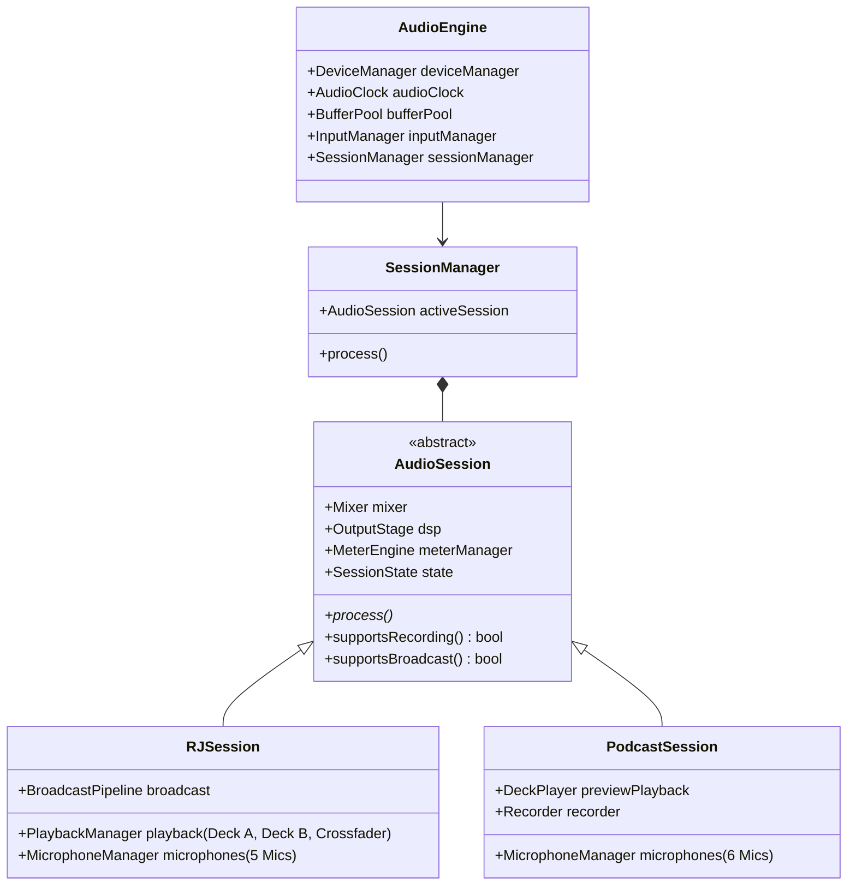

# SessionManager Architecture

## Overview
The MelodyMeet Native Audio Engine is being refactored to support isolated runtime sessions. Instead of generic identical containers, the architecture employs a shared core with specialized session implementations derived from it: `RJSession` and `PodcastSession`. 

Each session only owns the audio-engine components required for its specific workflow, explicitly excluding application-layer responsibilities (e.g., episode metadata, markers, UI state).

## 1. Old Architecture vs. New Architecture

### Old Architecture
Currently, `AudioEngine` is a monolithic God-class that directly owns all components, mixing DJ features with podcast features.

### New Architecture
`AudioEngine` owns the shared hardware resources and a `SessionManager`. The `SessionManager` manages polymorphic `AudioSession` instances (`RJSession` and `PodcastSession`), which own their specialized runtime components.

## 2. Ownership Refactor

### Shared Engine Components (Owned by `AudioEngine`)
- `DeviceManager`, `AudioClock`, `BufferPool`, `InputManager`, `EngineStatistics`, `AudioCallback`
- *Note:* `InputManager` acts as a shared hardware capture service, pushing audio to the `SessionManager`, which distributes it to the appropriate session(s).

### Shared AudioSession Core (Owned by `AudioSession` Base Class)
These exist in every session type:
- `Mixer`
- `OutputStage` (DSP)
- `MeterEngine` (MeterManager)
- `SessionState`

### RJ Session Components (Owned by `RJSession`)
- **PlaybackManager**: Deck A, Deck B, Crossfader, Cueing, Pitch, Loop.
- **MicrophoneManager**: RJ Mic, Guest Mic 1, 2, 3, Call-In Mic.
- **Broadcast**: `BroadcastPipeline`.
- **Monitoring**: Live Metering & Headphone Routing.

### Podcast Session Components (Owned by `PodcastSession`)
- **Preview Playback**: Simplified single `DeckPlayer` for preview playback (Load, Play, Pause, Stop, Seek).
- **Recorder**: Start, Pause, Resume, Stop.
- **MicrophoneManager**: Host Mic, Guest Mic 1, 2, 3, Remote Guest, Call-In Mic.
- **Recording Pipeline**: Audio encoding and `.wav` writing.
- **Monitoring**: Live Metering & Headphone Routing.

*(Application layer concepts like Chapters, Metadata, Remote Guest Signaling, and Publishing are strictly omitted from the C++ Engine.)*

## 3. Core Refinements

1. **Processing Independence**: `SessionManager::process` iterates and evaluates sessions based on their internal runtime state (e.g., active broadcasting or recording), not based on which session is visually "active" in the UI. `activeSession` is strictly used for routing UI/API control commands.
2. **Hardware Capture Independence**: `InputManager` is completely uncoupled from session switching. It captures hardware audio from the OS and pushes it to `SessionManager`, which fans out the buffers to the relevant `MicrophoneManager`s.
3. **Strict Capability Routing**: Operations not supported by a session (e.g., calling `startBroadcast` on `PodcastSession`) do not silently no-op. `AudioSession` exposes capability flags (`supportsBroadcast()`) and explicitly rejects unsupported commands.

## 4. Implementation Plan & Files Modified

1. **Rename** `src/core/AudioSession.h/.cpp` to `src/core/SessionState.h/.cpp`.
2. **Create** `src/engine/MicrophoneManager.h/.cpp` with channel configuration support.
3. **Create** `src/engine/PlaybackManager.h/.cpp` to encapsulate RJ Deck A/B and crossfader.
4. **Create** `src/engine/AudioSession.h/.cpp` (Base class).
5. **Create** `src/engine/RJSession.h/.cpp` and `src/engine/PodcastSession.h/.cpp`.
6. **Create** `src/engine/SessionManager.h/.cpp`.
7. **Modify** `src/engine/AudioEngine.h/.cpp`:
   - Strip all session-specific instances (Decks, Recorder, Broadcaster).
   - Inject `SessionManager`.
   - Update generic API endpoints to resolve through the active session.
8. **Modify** `src/audio/AudioCallback.h/.cpp` to route via `SessionManager::process()`.
9. **Modify** `src/audio/input/InputManager.h/.cpp` to route hardware buffers into the `SessionManager`.
