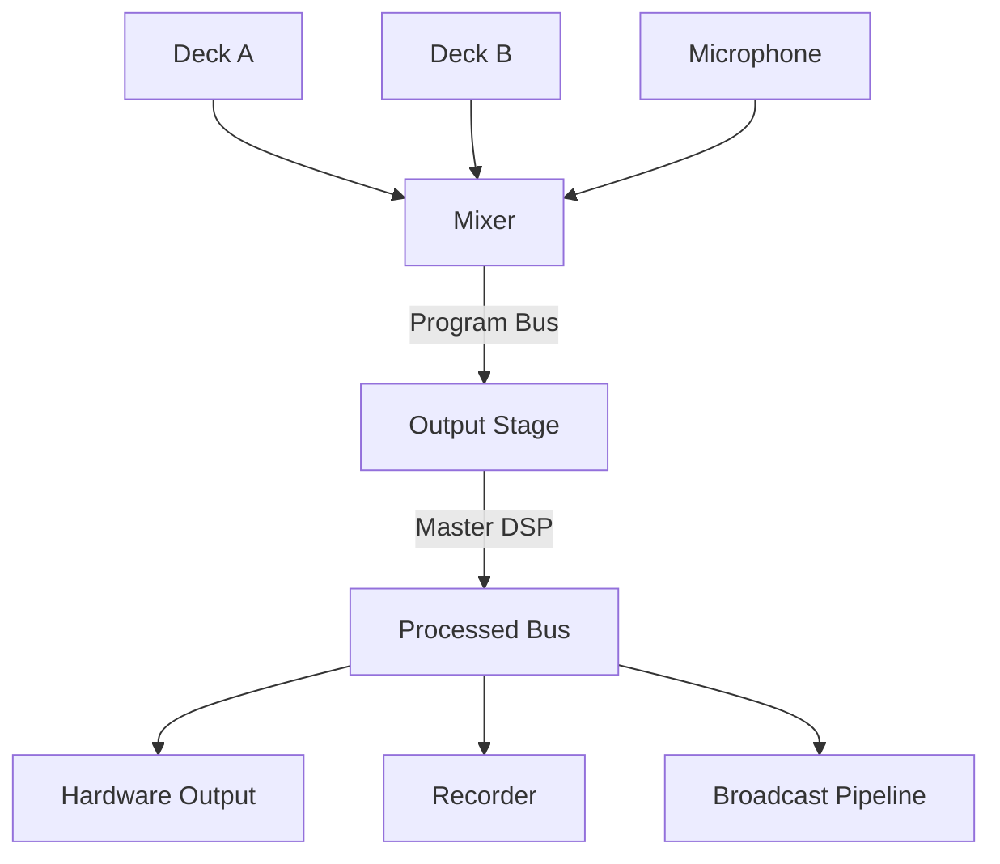

# MelodyMeet Audio Engine

A low-latency, real-time audio engine designed for broadcast, podcasting, and DJ environments. Built in C++17 leveraging the JUCE framework for cross-platform audio device management.

## Status

**Version 1.0.0 (Engine Freeze)**
Ready for integration with MelodyMeet RJ Studio and Podcast Studio.

## Architecture Overview

The MelodyMeet Audio Engine follows a robust, multi-threaded architecture with strict separation between control and real-time audio threads.

### Signal Flow


### Core Features
* **Lock-free Audio Thread**: Zero heap allocations, zero locks, and no blocking operations in the audio callback.
* **Mixer**: Handles multi-channel routing with thread-safe parameter updates.
* **Master DSP**: Integrated EQ, Gain, Compressor, and Limiter.
* **Input Management**: First-class microphone support with low-latency FIFO buffering.
* **Statistics**: Real-time push-based metric gathering (EMA, peak loads, active sources).
* **Broadcast**: Pluggable pipeline for network streaming (Icecast/WebRTC capabilities handled externally).

## Directory Layout

* `src/audio/`: Core audio processing components.
  * `mixer/`: Multi-channel mixing and routing.
  * `dsp/`: Master processing chain and effects.
  * `input/`: Microphone capture and hardware input.
  * `output/`: Output stage and final delivery.
  * `recorder/`: Multi-track and master recording.
  * `broadcast/`: Internal broadcast pipeline distribution.
* `src/core/`: Common types, statistics, clock, and memory pools.
* `src/deck/`: Audio playback sources.
* `src/device/`: JUCE audio device manager wrapper.
* `src/engine/`: `AudioEngine` facade for high-level API access.
* `src/playback/`: Decoding and streaming file management.
* `examples/`: Standalone demo applications.
* `docs/`: Architecture documents and design decisions.

## Building the Engine

### Requirements
* CMake 3.22+
* C++17 compiler (MSVC, Clang, or GCC)
* vcpkg (for JUCE dependency)

### Build Instructions

1. Configure with CMake:
   ```bash
   cmake -B build -S . -DCMAKE_TOOLCHAIN_FILE=[path/to/vcpkg]/scripts/buildsystems/vcpkg.cmake
   ```
2. Build the engine and examples:
   ```bash
   cmake --build build --config Release
   ```

## Examples

The repository includes a standalone test application, `PlaybackExample`, which demonstrates how to initialize the engine, route audio, and manage the device lifecycle.

To run it:
```bash
./build/examples/PlaybackExample/Release/PlaybackExample.exe
```

This will run a suite of integration tests verifying playback, mixer routing, recording, DSP processing, and microphone capture.