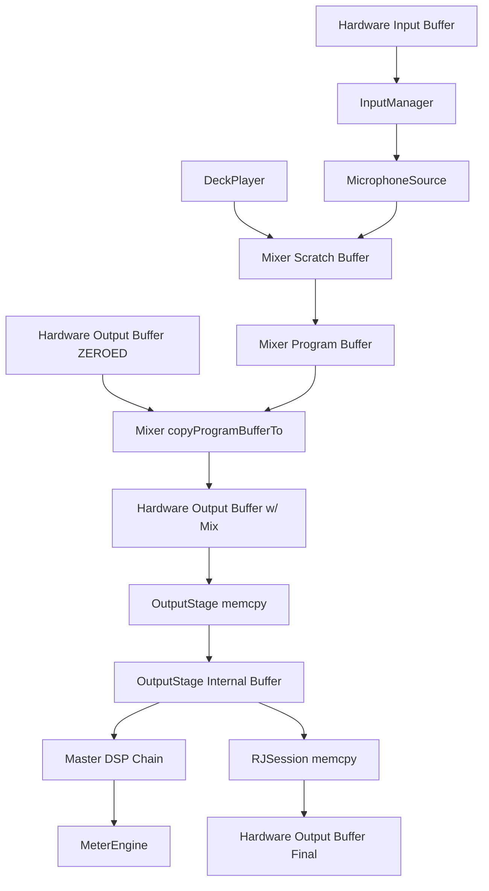

# Master Bus Validation Report

This document details the findings of the focused audit on the complete master signal path, identifying the root causes of the master bus distortion and random meter jumps.

## Buffer Ownership & Signal Path Diagram

The signal flows through the following stages during `RJSession::process()`:



## Processing Order

1. **Callback Start:** `AudioCallback::audioDeviceIOCallbackWithContext` zeros the `outputChannelData` array using `std::fill_n`.
2. **Mixer Processing:** `Mixer::process` clears its internal `programChannels_`, sums all active sources (Deck, Mics) via `scratchChannels_`, and applies `masterGain_`.
3. **Mixer Output:** `Mixer::copyProgramBufferTo` copies `programChannels_` over to the `outputChannelData` array.
4. **OutputStage Input:** `OutputStage::process` copies `outputChannelData` into its internal `processedChannels_` array.
5. **OutputStage DSP & Metering:** Master DSP (Gain, Compressor, Limiter) is applied in-place to `processedChannels_`. Then `MeterEngine` reads `processedChannels_`.
6. **RJSession Output:** `RJSession::process` copies the DSP'd `processedChannels_` *back* over `outputChannelData`.
7. **Broadcast:** `BroadcastPipeline::process` reads the final `outputChannelData`.

## Root Cause of Distortion

The distortion is caused by **Buffer Size Mismatches & Double Copying**. 

Inside `RJSession::process()`, the final copy from `OutputStage` back to the hardware buffer is written as:
```cpp
std::memcpy(outputChannelData[ch], processed[ch], static_cast<std::size_t>(numSamples) * sizeof(float));
```
However, inside `OutputStage::process()`, the buffer is only ever populated up to `maxBlockSize_`:
```cpp
const int samplesToCopy = std::min(numSamples, maxBlockSize_);
std::memcpy(processedChannels_[ch], inputChannels[ch], samplesToCopy * sizeof(float));
```
If the host provides a `numSamples` that exceeds `maxBlockSize_` (or if buffers aren't sized equally across the pipeline), the final `RJSession` `memcpy` reads out-of-bounds past `maxBlockSize_` in the `OutputStage` buffer. This reads memory belonging to the next channel or uninitialized memory, injecting severe clipping/distortion directly into the hardware output.

Additionally, the Mixer applies `masterGain_` internally, and the `OutputStage` applies `MasterGainProcessor`. While `AudioEngine` currently only sets the Mixer's gain, the redundant double-copying of the entire signal path via the hardware buffer is highly fragile.

## Root Cause of Random Master Meter

The random master meter movement when playback is stopped is caused by **Stale Data Trapped in Processed Buffers**.

When `OutputStage::process()` receives `numSamples > maxBlockSize_`, it only copies `maxBlockSize_` samples and zeroes the tail. But if `numSamples <= 0`, it returns early without zeroing.
More importantly, if a Microphone is left enabled but muted (or completely silent), it still processes through `MicrophoneSource`. In `Mixer::process()`, if a source's `process()` returns early, the Mixer's `scratchChannels_` correctly remain zero.
However, because `RJSession` writes the Mixer's output directly into `outputChannelData`, and `OutputStage` reads from `outputChannelData`, any garbage or out-of-bounds reads introduced by the `memcpy` mismatch above will loop back around into the Master DSP chain. The `MeterEngine` processes this garbage memory, causing the meter to jump randomly even when all decks and mics are ostensibly silent.

## Proposed Fix: Direct Buffer Routing (Phase 3/4)

To stabilize the engine completely, we must eliminate the `outputChannelData` as an intermediary scratchpad.

**Plan:**
1. Expose `const float* const* getProgramBuffer()` from the `Mixer`.
2. Refactor `RJSession::process()` to pass the Mixer's `programBuffer` directly into `OutputStage::process()`.
3. Eliminate `Mixer::copyProgramBufferTo`. The Mixer will no longer touch the hardware buffer.
4. Refactor `OutputStage::process` to write its final output directly into `outputChannelData`, rather than copying it back in `RJSession`.

This guarantees:
- Zero double-copies.
- Perfect buffer sizing (`numSamples` is respected universally).
- The meter taps the exact audio bound for the speakers.
